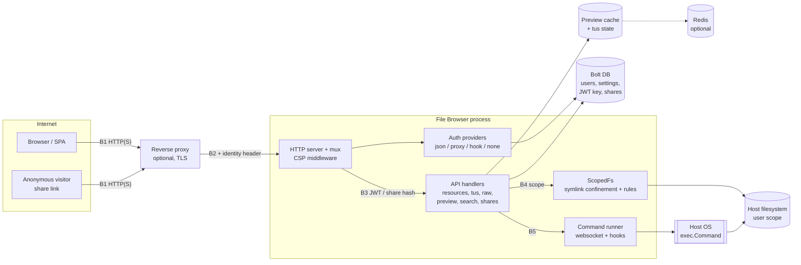

# STRIDE threat model: File Browser

**Target:** [filebrowser/filebrowser](https://github.com/filebrowser/filebrowser) at commit
`833d908884d5c801f30f5c098d7977177eb3a36b` (2026-07-28), about 15,600 lines of Go plus a Vue
frontend. A self-hosted web file manager with logins, file uploads, share links, a REST
API and an optional command runner.
**Method:** three parallel read-only subagents explored (1) architecture and trust
boundaries, (2) entry points and auth flows, (3) storage and secrets. Their reports were
merged here, and every `path:LINE` citation below was re-checked against the source
(`python scripts/check_citations.py <checkout>`). Findings are from static reading; nothing
was exploited or run. Where a claim is inferred rather than read, it says so.

## 0. Read this first: the project is end-of-life

On startup the server logs that File Browser "is being wound down" and was archived on
2026-09-01, "after which there will be no further releases and no security fixes"
(`cmd/root.go:195`, `cmd/root.go:197`). Every unmitigated
threat below is therefore permanent for this codebase. The practical mitigation for the
whole model is to put the app behind a hardened reverse proxy, minimise what it can reach,
and plan a migration (T0).

## 1. Architecture and data-flow diagram

One Go process serves the SPA and a JSON API (gorilla/mux). State lives in a Bolt database;
files live on the host filesystem under a per-user scope. See the diagram; boundaries B1 to
B6 are explained in section 2.

## 2. Trust boundaries

| ID | Boundary | What changes | Evidence |
|---|---|---|---|
| B1 | Internet to listener | Plain TCP by default, TLS optional, unix socket possible with mode 0666 by default | `cmd/root.go:91`, `cmd/root.go:217` |
| B2 | Reverse proxy to app | In proxy-auth mode the app trusts a username header from whoever connects | `auth/proxy.go:22` |
| B3 | Anonymous to authenticated | JWT (HS256, required expiry, 2 h) from `X-Auth`, or an `auth` cookie on GET only; user reloaded from DB each request | `http/auth.go:50`, `http/auth.go:123`, `http/auth.go:136`, `http/auth.go:22` |
| B3b | Share link to owner's files | Hash lookup, optional password or `?token=`, then runs as the share owner | `http/public.go:20`, `http/public.go:35` |
| B4 | User scope to host filesystem | `ScopedFs` resolves symlinks and rejects escapes unless `FollowExternalSymlinks` is set | `files/scoped.go:43`, `files/scoped.go:97` |
| B5 | App to spawned processes | Websocket commands and event hooks call `exec.Command`; off by default | `cmd/root.go:112`, `http/commands.go:88`] |
| B6 | Normal user to admin | Admin-only user and settings routes; settings include shell and commands | `http/settings.go:45`, `http/users.go:22` |

Assets worth protecting: the files in each user's scope; the JWT signing key (one key signs
every user's token); password hashes (bcrypt, `users/password.go:27`); share
tokens; the host itself (via the command runner).

## 3. Threats, ranked

Likelihood (L) and impact (I) are 1 (low) to 5 (high), judged for an internet-facing
instance with default settings unless noted. Risk = L x I.

| # | STRIDE | Threat | L | I | Risk |
|---|---|---|---|---|---|
| T0 | all | No security fixes will ever ship (project archived) | 5 | 4 | 20 |
| T1 | S | Login and share-password brute force: no rate limiting | 4 | 4 | 16 |
| T2 | S, E | Proxy-auth header spoofing impersonates any user, including admin | 3 | 5 | 15 |
| T3 | I | Admin password written to logs at first start | 3 | 4 | 12 |
| T4 | E | Command runner bypass or injection when exec is enabled | 2 | 5 | 10 |
| T5 | I, E | JWT signing key stored in plaintext in the DB (forge any token) | 2 | 5 | 10 |
| T6 | E, I | XSS steals the long-lived token (localStorage, non-HttpOnly cookie) | 2 | 5 | 10 |
| T7 | E, I | Symlink / TOCTOU escape from a user's scope | 2 | 5 | 10 |
| T8 | I | Share links: 48-bit ids, bypass token in the URL | 3 | 3 | 9 |
| T9 | R | No audit trail for successful actions | 4 | 2 | 8 |
| T10 | D | Few server timeouts and no quotas: slow-body and disk-fill DoS | 3 | 3 | 9 |
| T11 | I, T | Deployment defaults: weak Redis password, `latest` tags, plain HTTP, 0666 socket | 3 | 3 | 9 |
| T12 | T | Clickjacking: no frame-ancestors or X-Frame-Options | 3 | 2 | 6 |
| T13 | E | Stolen token cannot be revoked before it expires | 2 | 3 | 6 |

### T0. End-of-life project (cross-cutting)
**Evidence:** `cmd/root.go:197`. **Mitigation:** treat every other row as
unfixable upstream. Run it only behind an authenticating reverse proxy with network
restrictions, keep the container image pinned and rebuilt from a fork you control if you
must patch, and schedule a move to a maintained alternative.

### T1. Online password guessing (Spoofing)
`loginHandler` decodes the body and delegates to the configured authenticator with no
attempt counter, delay or lockout (`http/auth.go:156`); a search of `http/`,
`auth/` and `cmd/` for limiter code found none. The only brakes are bcrypt cost, a minimum
password length of 12 (`settings/settings.go:15`) and a
common-password list (`users/password.go:18`). Share passwords have the same
gap: the bcrypt check at `http/public.go:149` is unthrottled. A dummy bcrypt
compare for unknown users (`auth/json.go:17`) does prevent username
enumeration by timing.
**Mitigation:** rate-limit `/api/login` and `/api/public/*` at the reverse proxy (per-IP
and per-username), alert on bursts of 401s, require long unique passwords for admins.

### T2. Proxy-auth header spoofing (Spoofing, Elevation)
In proxy mode the username comes straight from a configurable header
(`auth/proxy.go:22`); unknown names are auto-created
(`auth/proxy.go:24`) as non-admin without Execute (`auth/proxy.go:50`).
Auto-creation is safe-ish, but a header naming an existing admin logs the caller in as that
admin. Nothing in the code restricts which source IP may send the header.
**Mitigation:** do not enable proxy auth unless the app listens only on loopback or a
private network reachable solely by the proxy; make the proxy overwrite or strip the header
on every request; prefer the JSON auth method otherwise.

### T3. Initial admin password in logs (Information disclosure)
Quick setup without `--password` generates a password and prints it:
`cmd/root.go:510`. Container log stores, CI logs and support
bundles then hold an admin credential.
**Mitigation:** pass a pre-hashed `--password` (`cmd/root.go:90`),
or change the admin password on first login and purge the first log lines.

### T4. Command runner bypass or injection (Elevation of privilege)
Exec is disabled by default (`cmd/root.go:112`) and each command needs
`Execute` plus an allow-listed name ([[http/commands.go|!d.server.EnableExec || !d.user.Perm.Execute]],
`http/commands.go:80`). The allow-list checks only the first
parsed word (`runner/commands.go:52`]). When a shell is configured the whole raw string is
handed to it (`runner/parser.go:21`), so by reading the code an input
such as `allowedcmd ; other` (spaces around the `;`) passes the name check and the shell runs both.
This was not exercised. Event hooks expand `$FILE`, `$DESTINATION` and `$USERNAME`, which hold
user-controlled names, and fall back to any environment variable
(`runner/runner.go:81`). Children inherit the full environment
(`runner/runner.go:93`), and the auth hook receives the plaintext password
(`auth/hook.go:92`).
**Mitigation:** leave exec disabled; if needed, do not configure a shell, allow only fixed
binaries that accept no dangerous flags, and run the container with no secrets in its
environment and a read-only root filesystem.

### T5. Plaintext JWT key (Information disclosure, Elevation)
One 512-bit key signs all tokens ([[settings/settings.go|Key                   []byte]]) and is persisted
unencrypted in the Bolt settings bucket (`storage/bolt/config.go:18`). The
database file is mode 0640 (`cmd/utils.go:26`). Anyone who can read the DB or
a backup of it can mint an admin token, since tokens are validated only by signature and expiry
(`http/auth.go:123`). There is no rotation mechanism that I found.
**Mitigation:** restrict the DB volume to the service user, exclude it from broad backups or
encrypt them, and rotate the key (re-initialise config) after any suspected exposure.

### T6. Token theft via XSS (Elevation, Information disclosure)
The SPA stores the JWT in `localStorage` (`frontend/src/utils/auth.ts:15`) and in a
cookie set from JavaScript, so it cannot be HttpOnly (`frontend/src/utils/auth.ts:13`). Any script
execution in the app origin yields a 2 h admin-capable token. Uploaded files can be served inline
(`http/raw.go:67`), but that response carries `script-src 'none'` and nosniff
(`http/raw.go:227`), which blocks script from uploaded HTML or SVG; markup injection and
phishing pages remain possible. The server injects a JSON blob into the index page
(`http/static.go:88`); its escaping was not reviewed.
**Mitigation:** serve user content from a separate origin if you can, keep the CSP at the proxy
as well, shorten token lifetime, and review `static.go` escaping before trusting it.

### T7. Scope escape through symlinks (Elevation, Information disclosure)
`ScopedFs` is the main confinement and resolves symlinks before access
(`files/scoped.go:97`). The checks are path based, so a swap between check and use is a
theoretical TOCTOU (inferred, not demonstrated). The `FollowExternalSymlinks` option turns the
protection off entirely (`files/scoped.go:44`).
**Mitigation:** never enable the option; give the process a dedicated user who can read only the
served tree; mount that tree separately and avoid symlinks in it.

### T8. Weak share-link identifiers (Information disclosure)
Link ids are 6 random bytes ([[http/share.go|make([]byte, 6)]]), about 48 bits, which is a
large but enumerable space with no throttling (see T1). Password-protected links also have a
96-byte bypass token ([[http/share.go|make([]byte, 96)]]) accepted from the query string
(`http/public.go:145`), which leaks into proxy logs, browser history and Referer
headers. Expiry is enforced when links are read (`share/storage.go:40`).
Shares re-check that the owner still has Share and Download rights, and re-root the file system
(`http/public.go:72`).
**Mitigation:** always set a password and an expiry on shares; strip query strings from proxy
logs; rate-limit `/api/public/`.

### T9. Weak audit trail (Repudiation)
Requests are logged only when the status is 400 or higher
(`http/data.go:106`), with the client IP from `realip` (`http/data.go:107`),
which trusts forwarding headers. Successful uploads, deletes, shares and settings changes leave no
record, so a malicious or compromised user cannot be traced.
**Mitigation:** log all state-changing requests at the reverse proxy (method, path, user, IP) and
ship them off-host.

### T10. Denial of service (Denial of service)
The server sets only a header-read timeout (`cmd/root.go:255`), so slow request
bodies are not bounded by the app. Resumable uploads are accepted up to a declared length
(`http/tus_handlers.go:134`) with no per-user quota that I found (inferred).
**Mitigation:** set body and idle timeouts and size limits at the proxy, put the served tree on a
filesystem with quotas, and cap concurrent connections per IP.

### T11. Risky deployment defaults (Tampering, Information disclosure)
The sample compose file ships a fixed Redis credential
(`compose.yaml:12`), unpinned images
(`compose.yaml:4`) and a plain-HTTP published port
(`compose.yaml:8`). The unix socket defaults to mode 0666
(`cmd/root.go:91`). The image does run as a non-root user (`Dockerfile:40`).
**Mitigation:** change the Redis password, pin images by digest, terminate TLS in front, and set
`--socketPerm 0660`.

### T12. Clickjacking (Tampering)
The CSP is `default-src 'self'; style-src 'unsafe-inline';` (`http/http.go:35`)
with no `frame-ancestors`, and no Go code sets X-Frame-Options or HSTS (searched all `*.go`
files). The app can be framed by another site.
**Mitigation:** add `X-Frame-Options: DENY` (or `frame-ancestors 'none'`) and HSTS at the proxy.

### T13. No token revocation (Elevation)
A stolen token works until it expires (2 h, `http/auth.go:22`). Permissions are re-read
from the user record on each request, so deleting or demoting the user takes effect at once
(`http/auth.go:136`), but there is no per-token revocation list.
**Mitigation:** keep token lifetime short and disable the user on suspected theft.

## 4. Things I checked that look fine
- JWT algorithm is pinned to HS256 and expiry is required (`http/auth.go:123`).
- Cookie auth is accepted on GET only, with state changes needing the custom header
  (`http/auth.go:59`); the cookie is `SameSite=Strict`.
- Signup is off by default and signed-up users are never admin or Execute
  (`http/auth.go:185`, `http/auth.go:218`).
- Share list responses omit the password hash and bypass token (`http/share.go:23`);
  token compare is constant time (`http/public.go:145`).
- Mutating resource routes require both a permission and a path-rule check
  ([[http/resource.go|!d.user.Perm.Create || !d.Check(r.URL.Path)]]).

## 5. Not verified
- Whether the preview cache (`http/preview.go:157`) can serve one user's thumbnail to
  another; the key is the real path, mtime and size, and the order of the permission check versus the
  cache lookup was not traced.
- How `img/service.go` invokes external tools for thumbnails.
- Escaping in the Vue frontend (only `auth.ts` was read).
- Any behaviour at runtime; no exploit or dynamic test was attempted.
