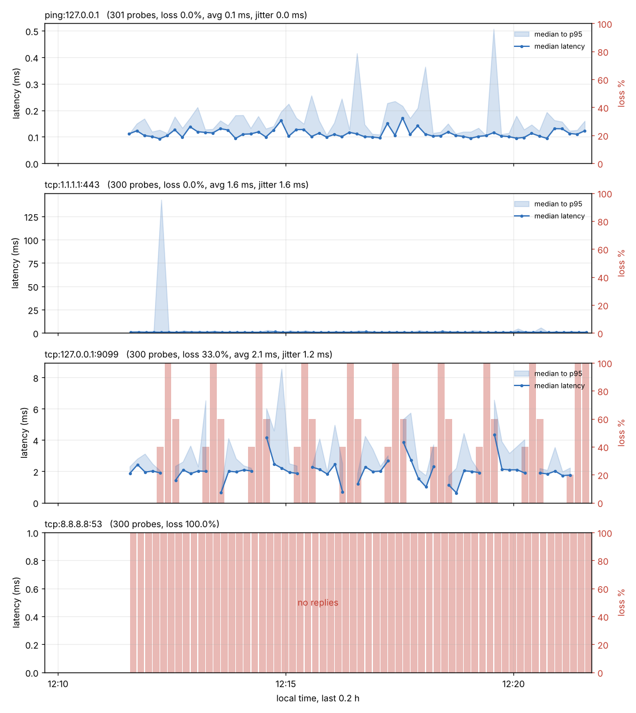

# netmon

An asyncio latency, jitter and packet-loss monitor. It pings (ICMP) and TCP-connects to a list of
hosts every N seconds, stores every probe in SQLite, prints terminal alerts when thresholds are
crossed, and draws a PNG chart per host.

```bash
pip install -e '.[dev]'
pytest                                   # 42 tests

netmon run ping:1.1.1.1 tcp:8.8.8.8:53 tcp:9.9.9.9:53 -i 5 --db netmon.db
netmon run -f targets.txt --max-latency 150 --max-loss 10      # one target per line
netmon report --db netmon.db --hours 24  # loss, avg, p95, jitter, failure reasons
netmon chart  --db netmon.db --hours 24 -o netmon.png
```

Targets: `ping:HOST`, `tcp:HOST:PORT`, `HOST:PORT` (TCP) or a bare `HOST` (ping). Ping uses an
unprivileged ICMP socket if the kernel allows it, otherwise a raw socket (needs root); if neither
works, `run` stops with a message instead of recording fake loss.

## What it measures

- **Latency**: ICMP round trip, or the time of a full TCP handshake.
- **Loss**: a probe that times out, is refused or fails DNS. The reason is stored (`netmon report` lists them).
- **Jitter**: mean absolute difference between consecutive successful probes (not the smoothed RFC 3550 estimator).
- **Alerts**: loss %, average latency and jitter over the last `--window` probes (default 10) are
  compared with `--max-loss` (20), `--max-latency` (200 ms), `--max-jitter` (50 ms). Each alert prints once
  when a metric crosses its limit and once when it recovers; nothing is judged before 5 probes.
- A summary line per target prints every `--summary-every` seconds.
- Probes run on a fixed schedule and targets are staggered; `--timeout` may not exceed `--interval`.
  Ctrl-C stops cleanly and does not record a half-finished probe.

## Chart

One panel per target: median latency with a median-to-p95 band, and loss % as red bars (right axis).
Probes are grouped into buckets of about 5 probes, or at most 300 buckets across the window, so a
24-hour chart stays readable. Gaps in the data break the line instead of being interpolated.



## Verified run (sandbox, 2026-10-22)

10 minutes at 2 s intervals against four targets, 1,201 probes, no errors or tracebacks:

| Target | Result |
|---|---|
| `ping:127.0.0.1` | 0% loss, avg 0.1 ms |
| `tcp:127.0.0.1:9099` | `tools/flaky_server.py` (40 s up, 20 s down): 33% loss. The chart's loss bars line up with the server's own up/down log; 1 of 300 probes disagreed, at a transition boundary |
| `tcp:1.1.1.1:443` | 0% loss, avg 1.6 ms |
| `tcp:8.8.8.8:53` | 100% loss, ALERT fired once |

**Caveats.** The sandbox cannot reach public DNS resolvers on port 53 (blocked), and its HTTPS egress is
intercepted by a local proxy, so the `1.1.1.1:443` latency is the proxy's, not the real network's. I could
not ping or probe public resolvers over ICMP/TCP-53 here, so real-internet latency numbers are unverified;
the loss and chart logic was checked against a local server with known up/down times instead. The 10-minute run
used the code just before two small fixes (cancelling probes on stop, and chart bucketing and gap handling);
after them I re-ran the tests, a 20-second run and the chart.

## Layout

`netmon/probes.py` (TCP and ICMP), `stats.py`, `alerts.py`, `store.py` (SQLite), `monitor.py` (loop),
`chart.py`, `cli.py`; `tools/flaky_server.py` is a dev helper that goes down on a schedule.

## Limits

- IPv4 only for ICMP. No scheduling of reports, no retention/pruning of old rows.
- Alerts only print to the terminal (no webhook or email).
- Probes for one target never overlap, so a target slower than its interval skips slots.
