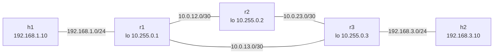

# ospf-lab

An OSPF lab as code: three FRRouting routers in a triangle, two Linux hosts, OSPF area 0 with loopbacks, a verification script and a link-failure demo, all driven from a Makefile.



All links have OSPF cost 10, point-to-point network type, hello 1s / dead 3s (fast on purpose, so failover is quick). The LAN-facing interfaces are passive.

## Quick start

Needs Docker, [containerlab](https://containerlab.dev/install/) and Python 3.10+.

```
make up       # deploy the lab
make verify   # waits for OSPF to converge, then runs 19 checks
make failover # break r1-r3, watch reconvergence, restore
make down
```

Other targets: `make break [LINK=r1-r3|r1-r2|r2-r3]`, `make restore`, `make show` (neighbours and routes), `make test` (unit tests, no lab needed).

## What `make verify` checks
- all five containers run
- each router has two OSPF neighbours in state Full
- each router has installed OSPF routes to every other loopback and the remote LAN(s)
- ping h1 <-> h2 and both hosts to all three loopbacks

It retries for up to 90 s while OSPF converges and exits non-zero on failure.

## Failover
`make failover` pings h1 -> h2 every 0.2 s, takes `r1:eth2` (the r1-r3 link) down, polls r1's route to 192.168.3.0/24, then brings the link back. Real output ([docs/failover-demo.txt](docs/failover-demo.txt)):

```
before: r1 reaches 192.168.3.0/24 via 10.0.13.2
r1-r3: r1:eth2 down
after:  r1 reaches 192.168.3.0/24 via 10.0.12.2 (route changed 0.20s after the break)
r1-r3: r1:eth2 up
ping h1 -> h2: 80/80 replies, 0 lost = about 0.0s without connectivity
restored: r1 reaches 192.168.3.0/24 via 10.0.13.2
FAILOVER DEMONSTRATED
```

Traffic moves from the direct path (r1-r3) to the two-hop path through r2 and back. Note: `ip link set down` gives the router instant carrier loss. A silent failure (cable in place, packets dropped) would take up to the 3 s dead interval; that case was not tested.

## Verified and not verified
- Verified here: `make up`, `make verify` (19/19) and `make failover` against FRR 8.4.1 and Alpine 3.20; 11 unit tests pass.
- Not run on a standard host. This was built in a sandbox that cannot download containerlab releases and whose kernel lacks `/proc/modules` and IPv6 sysctls, so containerlab was built from source (v0.82.0) with two local patches (skip the kernel-module check, drop the default `disable_ipv6` sysctl). A normal Docker host does not need them. Images came from `mirror.gcr.io` via `FRR_IMAGE` and `HOST_IMAGE` (defaults are the Docker Hub images).
- In the sandbox r1's zebra missed its startup timeout once and watchfrr restarted it; OSPF then converged on its own. `make verify`'s retry window covers that.
- Only OSPFv2 over IPv4; no authentication, no multi-area, no ECMP assertions (the r2/r3 routes to the far transit link are ECMP, but the checks only require a route).
