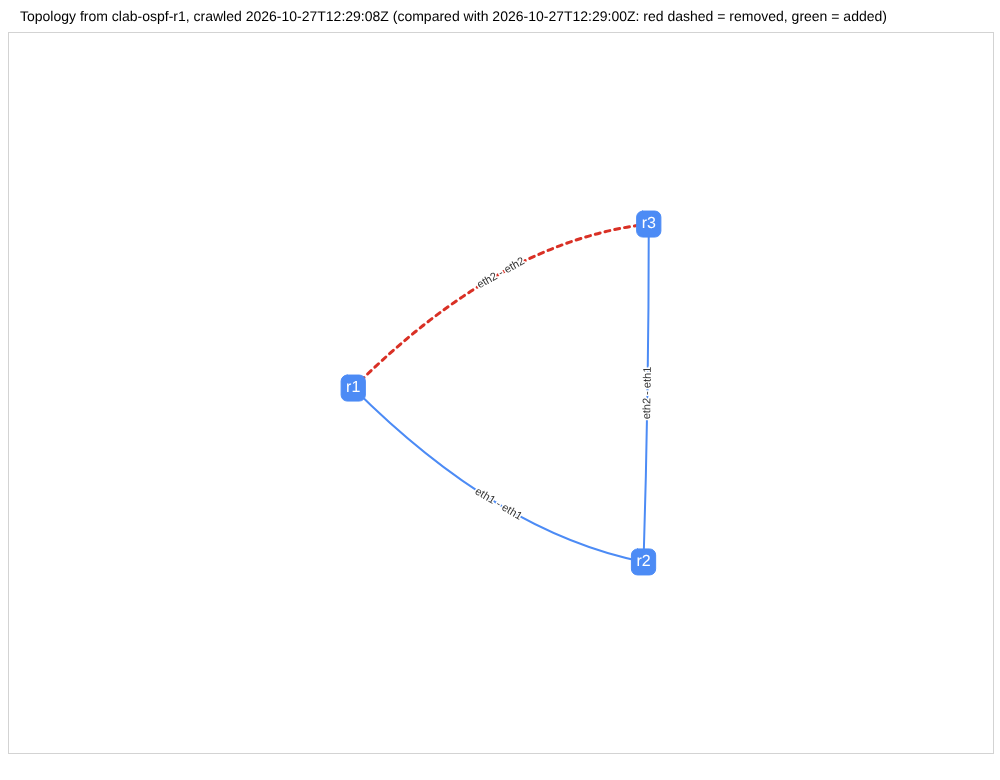

# lldpmap

Discover a network from one device. Logs in to a seed, reads its LLDP (and CDP) neighbours, follows them hop by hop, and gives you a JSON topology, an interactive graph, and a diff against an earlier run.

```
seed --SSH--> neighbours --SSH--> their neighbours ...   (depth-limited, each device visited once)
                     |
        JSON topology  -->  interactive graph (pyvis)
        two JSON files -->  added / removed links and devices
```

## Usage
```
pip install -e '.[dev]'
export LLDPMAP_USER=... LLDPMAP_PASSWORD=...     # credentials come only from the environment

lldpmap crawl 10.0.0.1 --vendor frr --depth 3 -o runs/mon.json --html runs/mon.html
lldpmap diff runs/mon.json runs/tue.json --html runs/diff.html     # exit 1 if different
lldpmap render runs/mon.json -o runs/mon.html
```

- A neighbour is logged in to at the management address it advertises over LLDP; `--name-template 'host-{name}'` gives an address for neighbours that advertise none.
- The vendor of each neighbour is guessed from its LLDP system description (`Arista` -> eos, `Cisco` -> ios, otherwise `--default-vendor`).
- `--depth N` stops logging in N hops from the seed; devices further out are still recorded as not crawled (grey ellipses in the graph).
- An unreachable device is recorded with the reason and the crawl continues.
- In the graph hover a node for vendor and address, hover a link for both ends. In a diff graph a removed link is red and dashed, an added link is green.

## Vendor parsers
Three parsers share one contract (`lldpmap/parsers/base.py`): a neighbour command, a hostname command, `parse_neighbors`, `parse_hostname`, returning `Neighbor` records. They were written by three subagents, one per vendor, and unified behind that interface:

| vendor | command | format notes |
|---|---|---|
| FRR (lldpd) | `lldpcli show neighbors details -f json` | `interface` is a list, but a plain object when there is one neighbour; chassis is keyed by system name; `mgmt-ip` string or list; port id is a MAC, the interface name is in `port.descr` |
| Arista EOS | `show lldp neighbors detail` | text; interface header, one block per neighbour with chassis/port ids, system name, management addresses; name falls back to chassis MAC |
| Cisco IOS | `show lldp neighbors detail` and `show cdp neighbors detail` | text; LLDP and CDP have different field names and layout; CDP carries the outgoing port on the `Interface:` line; both merged and deduped |

## Demo on the NE-04 lab
`docs/demo.txt` and `docs/run/` are a real run: crawl r1, pull the r1-r3 cable, crawl again, diff.

```
$ lldpmap diff before.json after.json
topology diff: 2026-10-27T12:29:00Z -> 2026-10-27T12:29:08Z
- link removed: r1:eth2 <-> r3:eth2
```



To reproduce (Docker + containerlab; the lab's stock FRR image has no sshd or lldpd, so `lab/` builds one):
```
export LAB_SSH_PASSWORD=$(python3 -c 'import secrets;print(secrets.token_urlsafe(12))')
make lab-up
export LLDPMAP_USER=netops LLDPMAP_PASSWORD=$LAB_SSH_PASSWORD
make demo          # writes runs/*.json and runs/*.html
make lab-down
```

## Verified and not verified
- 52 tests pass without a lab (parsers, crawler on fake networks incl. loops, depth limit, unreachable devices, mixed vendors, diff, graph, CLI).
- Verified on real devices: the FRR/lldpd path only: a live crawl of the three-router lab over SSH, graph rendered in headless Chromium (screenshots in `docs/`), diff shows the removed link. The graph is the three routers; the lab's two Alpine hosts do not run LLDP so they are not discovered.
- **Not verified on real devices: the Arista EOS and Cisco IOS parsers.** Their fixtures are hand-written from documentation and the authors' knowledge, not captured from hardware. The EOS parser uses the text output because the JSON schema could not be confirmed; the Arista docs fetched showed only one text example. Treat both as likely-right starting points and capture real output before relying on them.
- The crawler's multi-vendor path (vendor guess, per-vendor login) is tested with a fake network, not with real mixed hardware.
- Netmiko auto-accepts unknown SSH host keys (its default); pin them outside a lab.
- Sandbox notes: the lab image was built through mirrors/proxy (`scripts/lab.sh` detects `HTTPS_PROXY`), and containerlab was the patched source build from NE-04.
